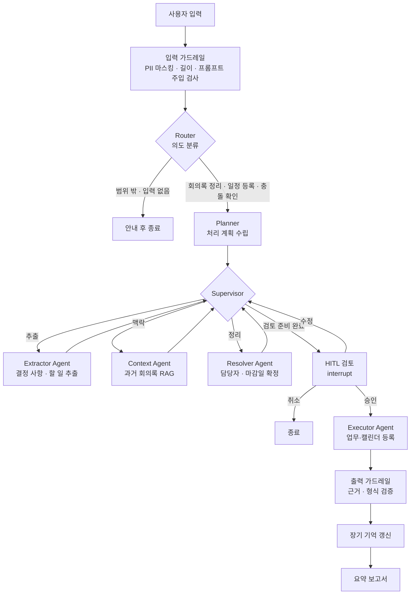
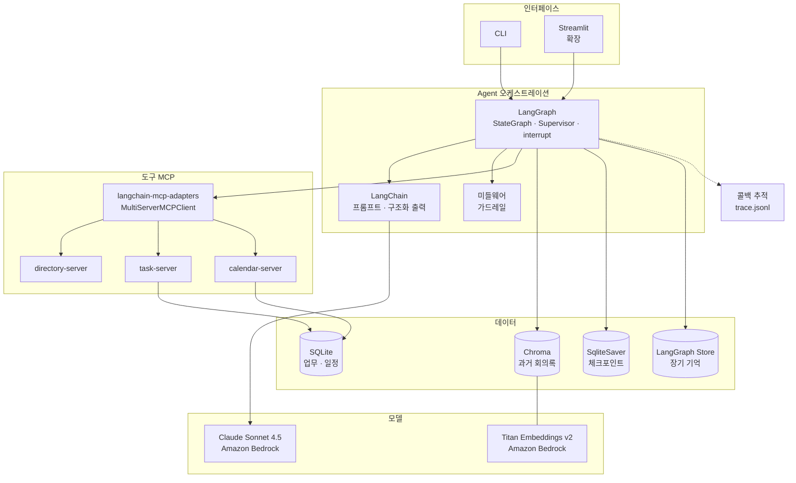

# MeetingOps Agent — 회의록을 업무로 바꾸는 Agent

회의록을 넣으면 **결정 사항과 할 일(Action Item)을 뽑고, 담당자와 마감일을 정한 뒤, 사용자 확인을 거쳐 업무 도구와 캘린더에 등록**하는 Multi-Agent 시스템입니다.

> 서비스 정의(사용자, 가치, 정책, 성공 기준)는 [SERVICE.md](SERVICE.md)를 참고하세요.
>
> SDS AX 과정(Day1~Day7) Mini PJT. LangChain, RAG, LangGraph, MCP, 미들웨어/가드레일, Multi-Agent, 장기 기억, 관측, 평가를 하나의 시나리오에 적용합니다.

---

## 1. 문제 정의

| 현재 문제 | Agent가 해결하는 방식 |
|---|---|
| 회의 후 할 일 정리가 늦거나 빠짐 | 회의록에서 할 일을 자동으로 추출 |
| "그건 김 책임이 해주세요"처럼 담당자 표현이 모호함 | 조직도 도구로 실제 직원과 매칭 |
| "다음 주 금요일까지" 같은 상대적인 날짜 | 회의 날짜를 기준으로 실제 날짜로 변환 |
| 이전 회의에서 정한 내용과 충돌 | 과거 회의록을 RAG로 검색해 관련 결정과 중복 할 일 표시 |
| 잘못된 등록이나 알림 발송 위험 | 등록 전에 사람 승인(HITL) |

### 사용 시나리오
```
사용자: (회의록 붙여넣기) "11/2 주간 개발회의 회의록입니다. 정리해서 등록해줘"
Agent : 결정 사항 3건, 할 일 5건을 찾았습니다.
        1) 로그인 API 응답 지연 원인 분석 — 담당: 김OO 책임 — 마감: 2026-11-06
        2) ... (담당자 불명확: "QA 쪽" → 후보 2명)
        ⚠ 4번 할 일은 10/26 회의의 할 일과 중복될 수 있습니다.
        수정할 내용이 있나요? [승인 / 수정 / 취소]
사용자: 2번 담당자는 박OO으로, 나머지는 승인
Agent : 5건 등록 완료. 회의 요약 보고서를 생성했습니다.
```

---

## 2. 범위

**포함 (MVP)**
- 텍스트(.txt / .md) 회의록 입력, 짧은 회의 메모, 일정 등록·결정 충돌 확인 요청 (4.8 입력 유형)
- 결정 사항과 할 일 추출 (구조화 출력)
- 담당자 매칭, 마감일 계산
- 과거 회의록 RAG 검색 (관련 결정, 중복 할 일)
- HITL 검토 후 업무 도구와 캘린더에 등록 (모의 MCP 서버)
- 입력·출력 가드레일, 장기 기억, 실행 추적, 평가셋

**제외 (확장 후보)**
- 음성 파일을 텍스트로 변환(STT)
- 실제 사내 시스템 연동 (Jira, Outlook 등)
- 웹 UI (MVP는 CLI 또는 노트북으로 진행, 여유가 있으면 Streamlit)

---

## 3. 아키텍처

### 3.1 전체 흐름 (LangGraph)



### 3.2 Agent 역할 (Supervisor 패턴, Day6)

| Agent | 역할 | 사용 도구 |
|---|---|---|
| **Router** | 입력 의도를 분류 (회의록 정리 / 일정 등록 / 결정 충돌 확인 / 범위 밖 / 입력 없음). 범위 밖·입력 없음은 안내 후 종료 | — |
| **Supervisor** | 기본은 규칙 순서(추출 → 맥락 → 정리 → 검토)로 다음 작업자를 고름. 출력 검증에 실패했을 때만 LLM이 어느 노드를 다시 실행할지 판단 | — |
| **Planner** | 의도와 회의록 유형(주간회의, 기획회의 등)에 맞춰 처리 단계 결정 (Day7 Planning) | — |
| **Extractor** | 결정 사항, 할 일, 미결 이슈를 구조화 출력으로 추출. 원문 근거 문장 포함 | — |
| **Context** | 과거 회의록에서 관련 결정을 찾고, 기존 업무와 중복되는 할 일을 검토 전에 찾음 | `search_past_meetings` (RAG), `find_duplicate_task` |
| **Resolver** | 담당자 표현을 실제 직원으로 매칭하고, 상대 날짜를 실제 날짜로 변환. 휴가·휴직과 기존 업무 확인 | `find_employee`, `get_team_members`, `check_availability`, `list_tasks`, `resolve_date` |
| **Executor** | 승인된 항목만 등록하거나 기존 업무의 기한을 변경 | `create_task`, `update_task`, `create_event` |

### 3.3 상태 스키마 (Day3 상태 관리)

```python
class ActionItem(BaseModel):
    id: str
    title: str
    assignee_raw: str              # 원문 표현: "김 책임", "QA 쪽"
    assignee_id: str | None        # 조직도 매칭 결과
    assignee_candidates: list[str] # 모호할 때 후보
    due_raw: str | None            # "다음 주 금요일"
    due_date: date | None
    due_ambiguous: bool            # "다음 주까지"처럼 해석이 갈리는 기한
    evidence: str                  # 근거가 된 원문 문장
    duplicate_of: str | None       # 중복 의심 기존 할 일 ID (승인 시 신규 등록 대신 기한 변경)
    confidence: float

class Decision(BaseModel):
    id: str
    summary: str                   # "대시보드 위젯 최대 12개, 지연 로딩 적용"
    topic: str                     # 안건명. 과거 결정 검색 키 ("대시보드 위젯")
    evidence: str                  # 근거가 된 원문 문장
    conflicts_with: list[str] = [] # 충돌하는 과거 결정 출처 (Context Agent가 채움)

class OpenIssue(BaseModel):        # 미결 이슈. 할 일로 등록하지 않고 보고서에만 표시
    id: str
    summary: str                   # "다이제스트 발송 시간 미정"
    follow_up: str | None          # "11/4 기획회의에서 결정" 같은 후속 처리 원문
    evidence: str                  # 근거가 된 원문 문장

class MeetingState(TypedDict):
    messages: Annotated[list, add_messages]
    intent: Literal["minutes", "schedule", "conflict_check", "out_of_scope", "empty"]
    raw_minutes: str
    masked_minutes: str
    meeting_meta: dict             # 날짜, 회의명, 참석자
    plan: list[str]
    decisions: list[Decision]
    action_items: list[ActionItem]
    open_issues: list[OpenIssue]
    related_context: list[Document]
    review_status: Literal["pending", "approved", "edited", "rejected"]
    registered: list[str]          # 등록된 task / event ID
    next_agent: str
```

---

## 4. 기능 상세 (수업 내용 매핑)

### 4.1 구조화 추출 — Day1 LCEL, Day4 Tool 정의
- `with_structured_output(ExtractionResult)`로 Pydantic 스키마 강제
- 할 일마다 **근거 문장(evidence)** 을 반드시 포함 → 없는 할 일을 지어내지 못하게 함
- Few-shot 예시 2~3개를 프롬프트에 포함

### 4.2 과거 회의록 RAG — Day2
- 데이터: `data/past_meetings/` 모의 회의록 15~20개
- 처리: 회의 단위 메타데이터(날짜, 팀, 회의명) + 안건 단위 청크 분할
- 저장소: Chroma (로컬)
- 품질 개선: 메타데이터 필터(같은 팀, 최근 N주), MMR, 필요하면 재정렬
- 품질 측정: RAGAS와 Hit@k로 검색과 경고 문구를 평가 (5.3 참고)
- 용도: "이전 회의에서 이미 정한 사항" 표시, 중복 할 일 탐지

### 4.3 MCP 서버 — Day4
모의 사내 시스템 3개를 FastMCP 서버로 구현합니다. 데이터는 JSON 또는 SQLite입니다.

| 서버 | 도구 | 데이터 |
|---|---|---|
| `directory-server` | `find_employee(name, title?)`, `get_team_members(team)` | `data/org.json` (직원 30명 내외, 동명이인 포함) |
| `task-server` | `create_task`, `update_task(task_id, due_date)`, `list_tasks(assignee)`, `find_duplicate_task(title)` | `data/tasks.db` |
| `calendar-server` | `create_event`, `check_availability(user, date)` | `data/calendar.db` |

- Agent 쪽은 `langchain-mcp-adapters`로 도구를 불러옵니다
- 도구 호출은 콜백 추적(4.7)으로 `trace.jsonl`에 남깁니다 (Day4-2)
- **장애 주입 테스트(Day4-6)**: 타임아웃, 빈 결과, 잘못된 응답에서 재시도하거나 사용자에게 알리는지 확인

### 4.4 Human-in-the-Loop — Day5
- `interrupt()`로 등록 직전에 멈추고 사용자에게 검토 표를 보여줍니다
- 사용자 응답: `approve` / 수정 / `reject`
  - 수정은 자연어로 받습니다 ("2번 담당자는 박지훈으로"). LLM이 `{id, field, value}`로 바꾸고, 바꾼 결과를 다시 보여 주어 확인받은 뒤 반영합니다
- **반드시 확인을 받는 경우**: 담당자 후보가 2명 이상, 신뢰도 0.7 미만, 중복 의심, 마감일이 지났거나 빠지거나 모호함, 담당자 휴가와 기한 충돌
- **승인 시 처리 규칙**
  - 담당자가 확정되지 않은 항목은 등록하지 않고 보고서의 "미확정 항목"에 남깁니다
  - 기한이 없는 항목은 기한을 비워 둔 채 등록합니다. 기한을 임의로 채우지 않습니다
  - 중복 의심 항목은 신규 등록하지 않습니다. 기존 업무와 기한이 다르면 `update_task`로 기한을 바꿉니다. 사용자가 수정으로 요청하면 신규 등록합니다
- 체크포인터(`SqliteSaver`)로 중단된 지점부터 다시 시작

### 4.5 가드레일 — Day5
| 구분 | 검사 | 처리 |
|---|---|---|
| 입력 | 주민번호, 전화번호, 계좌, 이메일 등 PII | 정규식으로 찾아 마스킹 후 진행 |
| 입력 | 외부인 이름 | 조직도에 없는 사람 이름을 LLM으로 찾아 마스킹 (조직도 직원 이름은 유지) |
| 입력 | 범위 밖 요청, 조직도 대량 조회, 연봉·평가 등 인사 정보 요청 | Router에서 거절 안내 |
| 입력 | 회의록 안의 프롬프트 주입 ("이전 지시를 무시하고…") | 탐지 후 해당 문장은 데이터로만 취급 |
| 입력 | 길이 초과, 회의록이 아닌 입력 | 거절 또는 분할 |
| 출력 | 근거 문장이 원문에 없음 | 해당 항목 제거 또는 재추출 |
| 출력 | 날짜와 담당자 형식 오류 | 검증 실패 시 Resolver 재실행 |
| 실행 | 등록 건수 이상 (예: 한 번에 20건 이상) | 등록 중단 후 확인 요청 |

미들웨어(Day5-1, 2)로 구현해 모든 LLM·도구 호출 앞뒤에 적용합니다.

### 4.6 장기 기억 — Day7
LangGraph `Store`에 사용자·팀별로 저장합니다.
- **호칭 매핑**: "QA 쪽" → 박OO (사용자가 HITL에서 수정한 내용을 학습)
- **기본 설정**: 마감일이 없을 때 기본 기간, 선호하는 등록 대상(업무 도구만 또는 캘린더도)
- **팀 정보**: 정기 회의명, 자주 나오는 프로젝트 약어

### 4.7 관측 — Day4-2, Day7
외부 추적 서비스(LangSmith 등)는 쓰지 않고, LangChain 콜백(`BaseCallbackHandler`)으로 실행 기록을 로컬 **`trace.jsonl`** 파일에 남깁니다. 계정 없이 동작하고, 평가 러너가 같은 파일에서 도구 호출을 읽어 판정합니다.

- 구현: `src/tracing.py`의 `JsonlTraceHandler(BaseCallbackHandler)`
- 연결: 그래프 실행 시 `config={"callbacks": [handler], "configurable": {"thread_id": ...}}`로 넘기면 노드, LLM, 도구 호출까지 모두 전달됩니다
- 저장 위치: `.env`의 `TRACE_PATH`(기본 `logs/trace.jsonl`). 한 줄에 이벤트 하나, 이어 쓰기(append)
- 평가 실행 시에는 `evaluation/results/<실행시각>/trace.jsonl`에 따로 남깁니다

**기록하는 이벤트**

| 콜백 메서드 | `event` | 주요 필드 |
|---|---|---|
| `on_chain_start` / `on_chain_end` | `node_start` / `node_end` | `node`(LangGraph 노드 이름), `latency_ms` |
| `on_chat_model_start` / `on_llm_end` | `llm_start` / `llm_end` | `model`, `latency_ms`, `input_tokens`, `output_tokens` |
| `on_tool_start` / `on_tool_end` | `tool_start` / `tool_end` | `tool`, `args`, `latency_ms` |
| `on_chain_error` / `on_llm_error` / `on_tool_error` | `error` | `name`, `error_type`, `message` |

- 모든 줄의 공통 필드: `ts`, `trace_id`(실행 1건 = 그래프 `thread_id`), `run_id`, `parent_run_id`
- 노드 이벤트는 LangGraph 노드(메타데이터 `langgraph_node`가 있는 체인)만 남기고, 내부 체인은 건너뜁니다

```json
{"ts":"2026-11-09T10:21:03.412+09:00","trace_id":"20261102_weekly-1","run_id":"…","parent_run_id":"…","event":"tool_end","tool":"find_employee","args":{"name":"김민준"},"output":"[{\"id\":\"E006\",…}]","latency_ms":84}
```

**기록 규칙**
- **기록 전에 PII를 마스킹합니다.** trace 파일도 출력물이므로 가드레일 정책 3([SERVICE.md](SERVICE.md) 4절)을 똑같이 적용합니다
- LLM 프롬프트와 응답 본문은 저장하지 않고 토큰 수만 남깁니다. 도구 인자와 결과는 마스킹 후 500자까지만 남깁니다
- 기록 중 오류가 나도 Agent 실행은 멈추지 않습니다 (핸들러 안에서 예외를 잡고 넘어감)

**집계**: `python -m src.tracing logs/trace.jsonl`로 실행(`trace_id`)별 노드 지연 시간, 토큰 사용량, 도구 호출 성공률을 출력합니다. 평가 보고서에는 이 집계와 `trace_id`를 적어 결과와 연결합니다.

### 4.8 처리 규칙

**입력 유형** (Router가 분류)

| 의도 | 예 | 처리 |
|---|---|---|
| 회의록 정리 | 회의록 파일, 짧은 회의 메모 + "등록해줘" | 전체 흐름 (추출 → 맥락 → 정리 → 검토 → 등록) |
| 일정 등록 | "캘린더에 일정 넣어줘" | 일정 정보 추출 → 참석자 가용성 확인 → 검토 → `create_event` |
| 결정 충돌 확인 | "이전 결정과 충돌하는지 확인해줘" | 과거 회의록 검색 → 출처를 붙여 충돌 보고. 등록하지 않음 |
| 범위 밖 | 점심 메뉴, 업무 삭제, 조직도 추출, 인사 정보 | 지원하지 않는다는 안내와 할 수 있는 일 예시 |
| 입력 없음 | "할 일 등록해줘" (회의록 없음) | 회의록 원문이나 파일 경로 요청 |

**캘린더 일정**
- 사용자가 일정 등록을 직접 요청했을 때만 만듭니다. 회의록 정리 중에는 할 일만 등록합니다

**기한 변환 규칙** (`resolve_date`, 기준일은 회의 날짜)

| 표현 | 변환 |
|---|---|
| "오늘", "내일", "수요일까지" | 해당 날짜 (요일은 기준일 이후 가장 가까운 날) |
| "이번 주 안에", "이번 주까지" | 이번 주 금요일 |
| "다음 주 ○요일" | 다음 주 해당 요일 |
| "다음 주까지" | 다음 주 금요일 + 모호함 표시(검토 요청) |
| "○○ 전까지" (예: QA 시작 전까지) | 기준 일정 직전 근무일 |
| "○○ 전날까지" (예: 배포 동결 전날) | 기준 일정 전 근무일 |
| "오픈 2주 전" 등 | 기준 일정에서 계산 |

- 기준 일정(배포 동결, QA 시작, 오픈)은 캘린더 마일스톤에서 찾고, 근거는 과거 회의록에서 인용합니다
- 결과가 주말이나 공휴일이면 앞쪽 근무일로 당깁니다
- 회의 날짜를 알 수 없으면 사용자에게 묻습니다

---

## 5. 평가 계획 — Day2-6, Day6-6, Day7-4

평가는 세 층으로 나뉩니다.

| 평가 | 파일 | 목적 |
|---|---|---|
| 과제 인-아웃 테스트 | [evaluation/test_queries.csv](evaluation/test_queries.csv) (20건) | 완성 판정. 전체 85% 이상, guardrail 100% ([SERVICE.md](SERVICE.md) 5절). 결과는 `round1_report.md`(Day 9), `round2_report.md`(Day 10) |
| 기능별 정량 평가 | `evaluation/dataset/meetings/` | 추출·담당자·날짜·라우팅 지표 (5.1, 5.2) |
| RAG 평가 | `evaluation/dataset/retrieval.jsonl` | 검색 품질, 경고 근거 (5.3) |

- 평가 러너는 케이스마다 업무·일정 DB를 `data/seed/`로 초기화합니다. 앞 케이스에서 등록한 업무가 뒤 케이스의 중복 판정에 섞이지 않게 하기 위해서입니다

### 5.1 평가셋
`evaluation/dataset/meetings/`에 정답이 표시된 회의록 **15~20건**을 준비합니다.

| 유형 | 건수 | 확인할 점 |
|---|---|---|
| 일반 주간회의 | 5 | 기본 추출 정확도 |
| 모호한 담당자 / 동명이인 | 3 | 후보 제시와 HITL 발생 여부 |
| 상대 날짜 다수 | 3 | 날짜 변환 정확도 |
| 과거 회의와 중복 | 2 | 중복 탐지 |
| 할 일이 없는 회의 | 1 | 할 일을 지어내지 않는지 |
| 프롬프트 주입 포함 | 2 | 가드레일 동작 |
| PII 포함 | 2 | 마스킹 |

### 5.2 지표
| 지표 | 목표 |
|---|---|
| 할 일 추출 Recall / Precision | ≥ 0.85 / ≥ 0.85 |
| 담당자 매칭 정확도 | ≥ 0.90 |
| 마감일 변환 정확도 | ≥ 0.90 |
| Router 의도 분류 정확도 | ≥ 0.90 |
| HITL이 필요한 경우 실제 발생률 | 100% |
| 가드레일 차단·마스킹 성공률 | 100% |
| 근거 없는 할 일 생성 수 | 0 |

- 할 일 제목 비교는 LLM-as-judge(의미 일치 여부)를 쓰고, 담당자와 날짜는 값이 정확히 같은지 비교합니다
- 평가 결과는 누적 기록(`evaluation/results/`)해 버전별로 비교합니다

### 5.3 RAG 평가 (RAGAS)

이 프로젝트의 RAG는 질문에 답하는 용도가 아니라, Context Agent가 **과거 회의록을 찾아 경고를 만드는 용도**입니다(결정 충돌, 중복 할 일, 날짜 계산 근거). 그래서 RAGAS 지표 중 이 용도에 맞는 것만 씁니다.

**평가 대상**
1. 검색: 필요한 과거 회의록을 찾았는가
2. 경고 생성: 경고 문구가 검색된 회의록 내용과 일치하는가

**평가셋** — `evaluation/dataset/retrieval.jsonl`, 18건 내외

검색 단계만 따로 측정하기 위해 질의를 고정합니다(추출 단계의 오류가 검색 점수에 섞이지 않게 함). 정답은 [data/README.md](data/README.md)의 "과거 회의록의 주요 결정" 표를 기준으로 만듭니다.

```json
{"id": "R01",
 "query": "대시보드 위젯 최대 개수를 12개로 확대",
 "source_sample": "20261102_weekly.md",
 "reference_sources": ["20260910_design_review.md"],
 "reference": "9/10 디자인 리뷰에서 메인 대시보드 위젯을 사용자당 최대 8개로 제한하기로 결정했다."}
```

| 유형 | 건수 | 예시 |
|---|---|---|
| 결정 충돌 | 4 | 위젯 개수(8개), 다이제스트 시간(9시) |
| 중복 할 일 | 4 | 로그인 캐시 운영 적용(T-032), 리허설 계획서(T-012) |
| 날짜 계산 근거 | 4 | 배포 동결 시작일, QA 시작일, 오픈일 |
| 일반 맥락 | 4 | 장애 원인, 보안 점검 결정 |
| 관련 회의록 없음 | 2 | 과거에 다룬 적 없는 주제 → 경고가 없어야 정상 |

**지표**

| 지표 | 측정 방법 | 목표 |
|---|---|---|
| Hit@4 / MRR | 정답 회의록 파일이 상위 4개 안에 있는지 (LLM 없음) | ≥ 0.90 / ≥ 0.75 |
| Context Precision (RAGAS) | 검색 결과에 관련 없는 청크가 섞였는지 | ≥ 0.80 |
| Context Recall (RAGAS) | 정답 내용을 검색 결과가 담고 있는지 | ≥ 0.85 |
| Faithfulness (RAGAS) | 경고 문구가 검색된 청크에 근거하는지 | ≥ 0.90 |
| 오경고율 | "관련 회의록 없음" 질의에서 경고를 만든 비율 | 0 |

- Answer Relevancy는 질문·답변 구조가 아니므로 쓰지 않습니다
- Hit@k는 비용이 없고 결과가 매번 같으므로, 청크 크기·MMR·메타데이터 필터를 바꿀 때마다 먼저 돌립니다. RAGAS는 설정을 정한 뒤 확인용으로 돌립니다

**실행 구성**
- 채점 LLM과 임베딩은 Bedrock 모델을 그대로 씁니다 (RAGAS의 LangChain 래퍼로 연결)
- 채점 모델과 생성 모델이 같아 점수가 후하게 나올 수 있으므로, 일부 항목은 사람이 직접 확인합니다
- RAGAS는 버전마다 API가 많이 바뀌므로 설치 후 확인한 버전으로 고정합니다

```python
# evaluation/run_ragas.py (요약)
from ragas import EvaluationDataset, evaluate
from ragas.embeddings import LangchainEmbeddingsWrapper
from ragas.llms import LangchainLLMWrapper
from ragas.metrics import Faithfulness, LLMContextPrecisionWithReference, LLMContextRecall

samples = [
    {
        "user_input": row["query"],
        "retrieved_contexts": [d.page_content for d in retriever.invoke(row["query"])],
        "response": context_agent_warning(row["query"]),   # Context Agent가 만든 경고 문구
        "reference": row["reference"],
    }
    for row in load_jsonl("evaluation/dataset/retrieval.jsonl")
]

result = evaluate(
    dataset=EvaluationDataset.from_list(samples),
    metrics=[LLMContextPrecisionWithReference(), LLMContextRecall(), Faithfulness()],
    llm=LangchainLLMWrapper(get_llm()),
    embeddings=LangchainEmbeddingsWrapper(get_embeddings()),
)
```

- 결과는 `evaluation/results/ragas_<날짜>_<설정명>.json`으로 저장해 설정별로 비교합니다

---

## 6. 폴더 구조

과제 규정 구조를 따릅니다. 

```
mini-pjt_jihyeon_kim/             
├── src/                          # 소스코드
│   ├── agent.py                  # [규정] 메인 에이전트 그래프 (StateGraph 조립, Supervisor 라우팅, HITL)
│   ├── tools.py                  # [규정] 도메인 도구 (MCP 도구 로딩, resolve_date, search_past_meetings)
│   ├── retriever.py              # [규정] RAG 파이프라인 (회의록 분할·임베딩·인덱싱·검색)
│   ├── nodes/                    # 작업 Agent 노드
│   │   ├── router.py
│   │   ├── supervisor.py
│   │   ├── planner.py
│   │   ├── extractor.py
│   │   ├── context.py
│   │   ├── resolver.py
│   │   └── executor.py
│   ├── state.py                  # 상태, Pydantic 스키마
│   ├── guardrails.py             # 입력·출력 가드레일 미들웨어
│   ├── memory.py                 # 장기 기억 Store
│   ├── llm.py                    # Bedrock 모델·임베딩 생성
│   ├── tracing.py                # 콜백 추적 (trace.jsonl 기록·집계)
│   ├── cli.py                    # 실행 진입점 (HITL 대화)
│   └── mcp_servers/              # 모의 사내 시스템 (MCP 서버)
│       ├── directory_server.py
│       ├── task_server.py
│       └── calendar_server.py
├── data/                         # [규정] 사용한 문서·데이터 (모두 가짜)
│   ├── README.md                 # 데이터 설명, 샘플별 정답 (RAG 인덱싱 제외)
│   ├── org.json                  # 조직도
│   ├── seed/                     # 업무·일정 초기 데이터 (MCP 서버가 SQLite로 적재)
│   ├── past_meetings/            # RAG용 과거 회의록 15건
│   └── samples/                  # 입력 회의록 5건
├── evaluation/
│   ├── test_queries.csv          # [규정] 인-아웃 세트 20건 (자체 평가·최종 채점 기준)
│   ├── round1_report.md          # [규정] 1차 자체 평가 결과 (Day 9)
│   ├── round2_report.md          # [규정] 2차 자체 평가 결과 (Day 10 · 개선 후)
│   ├── run_test_queries.py       # test_queries.csv 실행·판정
│   ├── run_eval.py               # 추출·담당자·날짜·라우팅 지표
│   ├── run_ragas.py              # RAG 평가 (Hit@k, RAGAS)
│   ├── dataset/
│   │   ├── meetings/             # 정답이 표시된 회의록 (기능 지표용)
│   │   └── retrieval.jsonl       # 검색 평가 질의와 정답
│   ├── tests/                    # pytest (가드레일, 라우팅, 장애 주입)
│   └── results/                  # 실행 결과, 평가별 trace.jsonl (git 제외)
├── logs/                         # trace.jsonl (git 제외)
├── SERVICE.md                    # [규정] 서비스 스펙
├── README.md                     # [규정] 프로젝트 설명
├── requirements.txt              # [규정] 의존성
├── .env.example                  # 모델 ID, AWS 리전, 경로(추적 파일 포함)
├── Dockerfile                    # [선택] 클린 환경 재현 (M9에서 작성)
└── run.sh                        # [선택] 인덱싱 → 실행 → 평가 일괄 실행 (M9에서 작성)
```

- `src/`, `evaluation/`은 `__init__.py` 없이 네임스페이스 패키지로 두고, 프로젝트 루트에서 `python -m src.cli`, `python -m evaluation.run_test_queries`처럼 실행합니다

---

## 7. 기술 구조

3장이 Agent가 **무엇을 어떤 순서로** 하는지라면, 이 장은 그 흐름을 **어떤 기술로 실행하는지**를 정의합니다.

### 7.1 계층 구조



- **Agent 코어(`src/agent.py`)는 라이브러리**로 만들고, CLI와 Streamlit은 같은 프로세스에서 그래프를 직접 호출합니다. 별도 API 서버는 두지 않습니다.
- HITL은 LangGraph 기능만으로 처리합니다: `interrupt()`로 멈추고 → 체크포인터에 상태 저장 → `Command(resume=...)`로 재개.
- MCP 서버는 Agent와 **별도 프로세스**로 실행합니다. 실제 사내 시스템으로 바꿀 때 서버만 교체하면 됩니다.

### 7.2 계층별 기술 선택

| 계층 | 기술 | 역할 | 선택 이유 |
|---|---|---|---|
| 언어 | Python 3.14 | 전체 구현 | 수업 실습 환경과 동일 |
| 인터페이스 | CLI (`argparse`) → Streamlit(확장) | 회의록 입력, HITL 검토 | CLI는 디버깅이 쉽고, Streamlit은 그래프를 직접 호출해 데모 화면을 빨리 만들 수 있음 |
| 오케스트레이션 | **LangGraph** | 상태 그래프, Supervisor 라우팅, `interrupt` | 조건 분기, 반복, 중단·재개가 필요한 흐름이라 체인보다 그래프가 맞음 (Day3, Day6) |
| 체인 구성 | **LangChain** (LCEL) | 프롬프트, 구조화 출력, 검색기 | 노드 내부의 단일 LLM 작업 구성 (Day1) |
| LLM | Claude Sonnet 4.5 on **Amazon Bedrock** | 추출, 라우팅, 판단 | 수업 제공 모델. `langchain-aws`의 `ChatBedrockConverse`로 연동 |
| 임베딩 | Titan Text Embeddings v2 on Bedrock | 회의록 벡터화 | LLM과 같은 AWS 계정, 자격 증명으로 사용 가능 |
| 도구 표준 | **MCP** (FastMCP) + `langchain-mcp-adapters` | 조직도, 업무, 캘린더 도구 | 사내 시스템을 표준 방식으로 연결, Agent 코드와 분리 (Day4) |
| 벡터 저장소 | Chroma (로컬 파일) | 과거 회의록 검색 | 별도 서버 없이 실행, 메타데이터 필터 지원 (Day2) |
| 업무 데이터 | SQLite | 모의 업무·일정 DB | 파일 하나로 동작, `data/seed/`에서 초기 적재 |
| 체크포인트 | `SqliteSaver` | 그래프 상태 저장, HITL 재개 | 프로그램을 다시 실행해도 검토 대기 중인 실행을 이어갈 수 있음 |
| 장기 기억 | LangGraph `Store` | 호칭 매핑, 사용자 설정 | 그래프 노드에서 바로 읽고 쓸 수 있음 (Day7) |
| 관측 | `BaseCallbackHandler` → `trace.jsonl` | 노드·LLM·도구 호출 기록, 지연 시간, 토큰 | 외부 계정 없이 로컬 파일로 남고, 평가 러너가 도구 호출 판정에 그대로 사용 (Day4-2, Day7) |
| RAG 평가 | **RAGAS** + Hit@k | 검색 품질, 경고 문구의 근거 검증 | RAG 표준 지표로 검색 설정 변경 효과를 수치로 비교 (Day2-6, Day7-4) |
| 설정 | `python-dotenv` | 모델 ID, 경로, 키 관리 | `.env` 하나로 환경 전환 |
| 테스트 | pytest | 가드레일, 라우팅, 장애 주입 테스트 | |

### 7.3 HITL 실행 흐름

검토 단계 때문에 실행이 한 번에 끝나지 않습니다. 실행마다 `thread_id`를 발급하고, 같은 `thread_id`로 재개합니다.

```python
# src/cli.py (요약)
config = {"configurable": {"thread_id": run_id}}

result = graph.invoke({"raw_minutes": minutes}, config)   # HITL 지점에서 멈춤
while "__interrupt__" in result:
    review = result["__interrupt__"][0].value             # 검토 표 (할 일, 경고)
    print_review(review)
    decision = ask_user()                                 # approve / edit / reject
    result = graph.invoke(Command(resume=decision), config)
```

Streamlit도 같은 방식입니다. `thread_id`를 `st.session_state`에 저장하고 버튼을 누를 때 `Command(resume=...)`를 호출합니다.

**확장: 외부 연동이 필요할 때**
- 다른 프로그램(웹 프론트엔드, 메신저 봇 등)이 Agent를 호출해야 하면 API를 추가합니다.
- 1순위는 **LangGraph Server**(`langgraph dev`)입니다. 실행 시작, 상태 조회, 재개 API를 직접 만들지 않아도 됩니다.
- 응답 형식을 직접 통제해야 하면 FastAPI로 감쌉니다. 코어 코드는 바뀌지 않습니다.

### 7.4 실행 구성

| 프로세스 | 실행 방법 | 비고 |
|---|---|---|
| CLI / Streamlit | `python -m src.cli <회의록>` / `streamlit run app.py` | 그래프를 같은 프로세스에서 실행 |
| MCP 서버 3개 | `MultiServerMCPClient`가 `stdio`로 하위 프로세스 실행 | 개발 단계 기본값. 분리 배포가 필요하면 `streamable-http`로 전환 |
| Chroma, SQLite | 로컬 파일 (`.chroma/`, `.state/`) | 서버 불필요 |

### 7.5 모델 설정

모델 ID는 `.env`로 관리해 코드 수정 없이 바꿀 수 있게 합니다.

```bash
# .env.example
MODEL=us.anthropic.claude-sonnet-4-5-20250929-v1:0
AWS_REGION=us-east-1
# AWS 자격 증명은 AWS CLI 프로필 또는 환경 변수로 설정
```

```python
# src/llm.py
import os
from langchain_aws import BedrockEmbeddings, ChatBedrockConverse

MODEL = os.getenv("MODEL", "us.anthropic.claude-sonnet-4-5-20250929-v1:0")
EMBEDDING_MODEL = os.getenv("EMBEDDING_MODEL", "amazon.titan-embed-text-v2:0")
REGION = os.getenv("AWS_REGION", "us-east-1")

def get_llm(temperature: float = 0.0):
    return ChatBedrockConverse(model=MODEL, region_name=REGION, temperature=temperature)

def get_embeddings():
    return BedrockEmbeddings(model_id=EMBEDDING_MODEL, region_name=REGION)
```

- 추출, 라우팅, 검증 노드는 결과가 일정하도록 `temperature=0`을 씁니다
- 평가(LLM-as-judge)도 같은 모델을 쓰고, 프롬프트만 분리합니다

---

## 8. 진행 계획

| 단계 | 작업 | 산출물 | 관련 수업 |
|---|---|---|---|
| **M0** 준비 ✅ | 환경 설정, 모의 데이터, 서비스 정의, 인-아웃 세트 | `data/`, `SERVICE.md`, `test_queries.csv`, `requirements.txt` | Day1 |
| **M1** 추출 체인 ✅ | Extractor 단독 체인 + 구조화 출력 + 근거 문장 | `nodes/extractor.py`, `state.py`, `llm.py` | Day1, Day4-1 |
| **M2** RAG ✅ | 과거 회의록 인덱싱, 검색, 중복 탐지, 검색 평가셋 작성과 Hit@k 측정 | `retriever.py`, `retrieval.jsonl` | Day2 |
| **M3** MCP 서버 | 조직도, 업무, 캘린더 서버 3개 + 도구 로딩 | `mcp_servers/`, `tools.py` | Day4 |
| **M4** 그래프 조립 | Supervisor + 작업 Agent 연결, 조건부 분기 | `agent.py`, `nodes/` | Day3, Day6 |
| **M5** 안전장치 | HITL interrupt, 입력·출력 가드레일 미들웨어 | `guardrails.py` | Day5 |
| **M6** 기억과 관측 | 장기 기억 Store, 콜백 추적(`trace.jsonl`) 연결 | `memory.py`, `tracing.py` | Day7 |
| **M7** 1차 자체 평가 | 인-아웃 세트 실행, 기능 지표·RAGAS 측정, 장애 주입 테스트 | `round1_report.md` | Day 9 |
| **M8** 개선·2차 자체 평가 | 1차 실패 케이스 개선 후 재평가 | `round2_report.md` | Day 10 |
| **M9** 마무리 | 데모 시나리오, (선택) Dockerfile·run.sh·Streamlit, 발표 자료 | 데모 영상 / 발표 자료 | |

> 우선순위: **M1 → M3 → M4 → M5**가 핵심 경로입니다. 시간이 부족하면 M2(RAG)와 M6(기억)를 간소화합니다.

---

## 9. 리스크와 대응

| 리스크 | 대응 |
|---|---|
| LLM이 없는 할 일을 만들어냄 | 근거 문장 필수 + 출력 가드레일에서 원문 대조 |
| 담당자 오매칭 | 신뢰도가 낮으면 반드시 HITL, 수정 내용을 장기 기억에 반영 |
| 상대 날짜 해석 오류 | LLM이 아닌 규칙 기반 `resolve_date` 도구로 계산 |
| Supervisor 무한 루프 | 최대 반복 횟수 제한(`recursion_limit`), 상태 기반 종료 조건 |
| MCP 서버 장애 | 재시도, 타임아웃, 실패 항목만 따로 보고 |

---

## 10. 실행 방법 (구현 후 작성)

```bash
# 설치
pip install -r requirements.txt
cp .env.example .env               # 값 채우기

# 과거 회의록 인덱싱
python -m src.retriever --ingest

# 실행
python -m src.cli data/samples/20261102_weekly.md

# 평가
python -m evaluation.run_test_queries   # 과제 인-아웃 테스트 (test_queries.csv)
python -m evaluation.run_eval           # 기능 지표
python -m evaluation.run_ragas          # RAG 평가
pytest evaluation/tests

# 추적 집계 (노드 지연 시간, 토큰, 도구 호출 성공률)
python -m src.tracing logs/trace.jsonl
```
