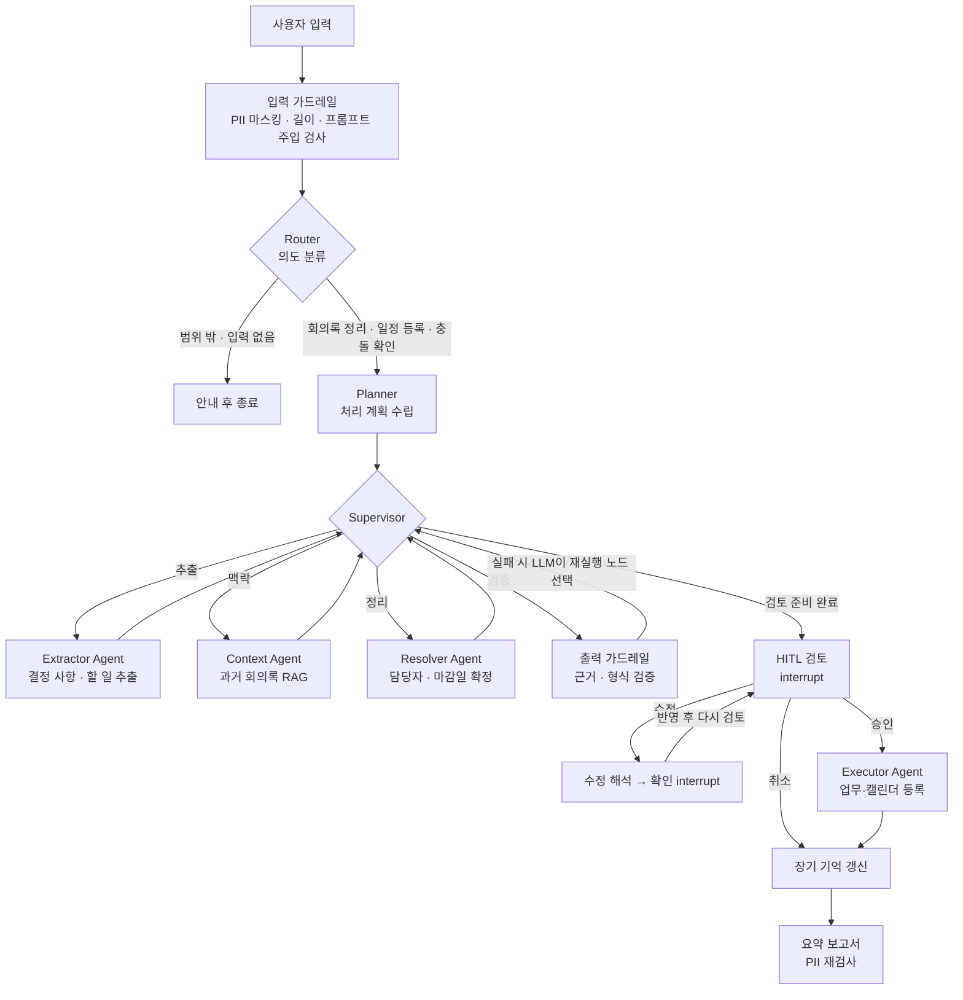
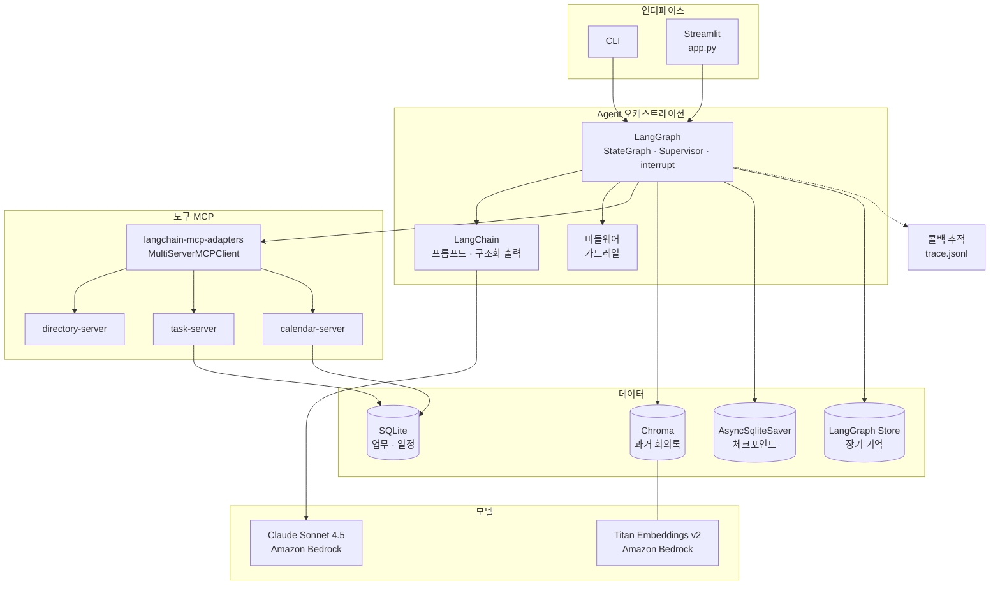

# MeetingOps Agent — 회의록을 업무로 바꾸는 Agent

회의록을 넣으면 **결정 사항과 할 일(Action Item)을 뽑고, 담당자와 마감일을 정한 뒤, 사용자 확인을 거쳐 업무 도구와 캘린더에 등록**하는 Multi-Agent 시스템입니다.

> 서비스 정의(사용자, 가치, 정책, 성공 기준)는 [SERVICE.md](SERVICE.md)를 참고하세요.
>
> SDS AX 과정(Day1~Day7) Mini PJT. LangChain, RAG, LangGraph, MCP, 미들웨어/가드레일, Multi-Agent, 장기 기억, 관측, 평가를 하나의 시나리오에 적용합니다.

---

## 1. 문제 정의

| 현재 문제 | Agent가 해결하는 방식 |
|---|---|
| 회의 후 할 일 정리가 늦거나 빠짐 | 회의록에서 할 일을 자동으로 추출 |
| "그건 김 책임이 해주세요"처럼 담당자 표현이 모호함 | 조직도 도구로 실제 직원과 매칭 |
| "다음 주 금요일까지" 같은 상대적인 날짜 | 회의 날짜를 기준으로 실제 날짜로 변환 |
| 이전 회의에서 정한 내용과 충돌 | 과거 회의록을 RAG로 검색해 관련 결정과 중복 할 일 표시 |
| 잘못된 등록이나 알림 발송 위험 | 등록 전에 사람 승인(HITL) |

### 사용 시나리오
```
사용자: (회의록 붙여넣기) "11/2 주간 개발회의 회의록입니다. 정리해서 등록해줘"
Agent : 결정 사항 3건, 할 일 8건을 찾았습니다.
        ⚠ 위젯 12개 확대는 9/10 디자인 리뷰의 "최대 8개" 결정과 충돌합니다.
        A3) 로그인 캐시 운영 반영 마무리 — 담당: 김민준 책임 — 마감: 2026-11-06
            ⚠ 10/26 회의의 기존 업무 T-032와 중복 의심 → 기존 업무 기한 변경
        A8) 알림 센터 회귀 테스트 시나리오 추가 — 담당 미정 ("QA 쪽" → 후보 4명)
        ...
        승인 / 거절 / 수정할 내용을 입력하세요.
사용자: A8 담당자는 박소율로
Agent : [A8] 담당자 → 박소율 선임(QA팀). 이대로 반영할까요?
사용자: yes → (검토 표를 다시 확인한 뒤) 승인
Agent : 신규 5건 등록, T-022 기한 변경. 회의 요약 보고서를 만들었습니다.
```

---

## 2. 범위

**포함 (MVP)**
- 텍스트(.txt / .md) 회의록 입력, 짧은 회의 메모, 일정 등록·결정 충돌 확인 요청 (4.8 입력 유형)
- 결정 사항과 할 일 추출 (구조화 출력)
- 담당자 매칭, 마감일 계산
- 과거 회의록 RAG 검색 (관련 결정, 중복 할 일)
- HITL 검토 후 업무 도구와 캘린더에 등록 (모의 MCP 서버)
- 입력·출력 가드레일, 장기 기억, 실행 추적, 평가셋

**제외 (확장 후보)**
- 음성 파일을 텍스트로 변환(STT)
- 실제 사내 시스템 연동 (Jira, Outlook 등)
- 웹 서비스 형태의 UI·다중 사용자 (데모용 Streamlit 화면 `app.py`는 M9에서 만듦)

---

## 3. 아키텍처

### 3.1 전체 흐름 (LangGraph)



- 실제 그래프는 모든 작업 노드가 Supervisor로 돌아오는 구조이고, 위 화살표는 Supervisor가 고르는 순서를 나타냅니다
- 입력 가드레일에서 차단(길이 초과)되면 바로 요약 보고서로 갑니다
- 취소(거절)해도 장기 기억 갱신을 거칩니다. 사용자가 확인한 수정은 승인 여부와 관계없이 학습합니다(4.6)

### 3.2 Agent 역할 (Supervisor 패턴, Day6)

| Agent | 역할 | 사용 도구 |
|---|---|---|
| **Router** | 입력 의도를 분류 (회의록 정리 / 일정 등록 / 결정 충돌 확인 / 범위 밖 / 입력 없음). 범위 밖·입력 없음은 안내 후 종료 | — |
| **Supervisor** | 기본은 규칙 순서(추출 → 맥락 → 정리 → 검토)로 다음 작업자를 고름. 등록할 항목이 없으면 검토·등록을 건너뛰고, 승인되지 않으면 Executor로 보내지 않음. 출력 검증에 실패했을 때만 LLM이 어느 노드를 다시 실행할지 판단(M5) | — |
| **Planner** | 의도에 맞춰 처리 단계 결정 (Day7 Planning). 지금은 규칙 기반이고, 회의 날짜도 규칙으로 찾음 | — |
| **Extractor** | 결정 사항, 할 일, 미결 이슈를 구조화 출력으로 추출. 원문 근거 문장 포함 | — |
| **Context** | 과거 회의록에서 관련 결정을 찾고, 기존 업무와 중복되는 할 일을 검토 전에 찾음 | `search_past_meetings` (RAG), `find_duplicate_task` |
| **Resolver** | 담당자 표현을 실제 직원으로 매칭하고, 상대 날짜를 실제 날짜로 변환. 휴가·휴직과 기존 업무 확인. 기한을 마일스톤으로 계산하면 근거 회의록을 찾아 붙임. 담당자를 확정한 뒤 그 사람의 진행 중 업무와 중복을 한 번 더 확인(M8, 제목 표현이 달라 Context가 놓친 중복 보완) | `find_employee`, `get_team_members`, `check_availability`, `list_tasks`, `resolve_date`, `search_past_meetings` |
| **Scheduler** | 일정 등록 요청에서 일정 정보를 뽑고 참석자·날짜·가용성 확정 (intent=schedule) | `find_employee`, `get_team_members`, `resolve_date`, `check_availability` |
| **Executor** | 승인된 항목만 등록하거나 기존 업무의 기한을 변경 | `create_task`, `update_task`, `create_event` |

**도구 호출과 LLM 판단의 분리**: Context·Resolver·Scheduler는 도구 호출 순서를 코드로 고정해 필요한 도구가 항상 호출되게 하고, 판단이 필요한 부분만 LLM이 정합니다(동명이인 선택, 기한 표현의 지시어 해석, 결정 충돌·실제 중복 여부). LLM이 고른 직원 ID·출처·업무 ID는 도구 결과 안에 있는 값만 받아들입니다.

### 3.3 상태 스키마 (Day3 상태 관리)

```python
class ActionItem(BaseModel):
    id: str
    title: str
    assignee_raw: str              # 원문 표현: "김 책임", "QA 쪽"
    assignee_id: str | None        # 조직도 매칭 결과
    assignee_candidates: list[str] # 모호할 때 후보
    due_raw: str | None            # "다음 주 금요일"
    due_date: date | None
    due_ambiguous: bool            # "다음 주까지"처럼 해석이 갈리는 기한
    evidence: str                  # 근거가 된 원문 문장
    duplicate_of: str | None       # 중복 의심 기존 할 일 ID (승인 시 신규 등록 대신 기한 변경)
    confidence: float
    warnings: list[str]            # 검토 표의 경고 (동명이인, 휴가 충돌, 중복, 기한 모호 등). 있으면 확인 필요
    notes: list[str]               # 참고 정보 (기한 계산 근거 회의록 등)
    excluded: bool                 # 사용자가 HITL에서 제외한 항목

class EventDraft(BaseModel):       # 일정 등록 요청 (intent=schedule)
    title: str
    date_raw: str                  # 원문 표현
    start_time: str | None
    end_time: str | None
    attendees_raw: list[str]       # 사람·팀 원문 표현
    evidence: str
    date: str | None               # 이하 Scheduler가 확정
    start: str | None
    end: str | None
    attendee_ids: list[str]
    warnings: list[str]

class Decision(BaseModel):
    id: str
    summary: str                   # "대시보드 위젯 최대 12개, 지연 로딩 적용"
    topic: str                     # 안건명. 과거 결정 검색 키 ("대시보드 위젯")
    evidence: str                  # 근거가 된 원문 문장
    conflicts_with: list[str] = [] # 충돌하는 과거 결정 출처 (Context Agent가 채움)

class OpenIssue(BaseModel):        # 미결 이슈. 할 일로 등록하지 않고 보고서에만 표시
    id: str
    summary: str                   # "다이제스트 발송 시간 미정"
    follow_up: str | None          # "11/4 기획회의에서 결정" 같은 후속 처리 원문
    evidence: str                  # 근거가 된 원문 문장

class MeetingState(TypedDict):
    messages: Annotated[list, add_messages]
    request: str                   # 사용자 입력 원문
    intent: Literal["minutes", "schedule", "conflict_check", "out_of_scope", "empty"]
    raw_minutes: str
    masked_minutes: str
    meeting_meta: dict             # 날짜, 회의명, 참석자, 원본 파일명
    plan: list[str]
    done: Annotated[list[str], operator.add]  # 끝난 단계 (Supervisor가 다음 단계 결정에 사용)
    decisions: list[Decision]
    action_items: list[ActionItem]
    open_issues: list[OpenIssue]
    event: EventDraft | None
    related_context: list[dict]    # 검색된 과거 회의록 청크
    review_status: Literal["pending", "approved", "edited", "rejected"]
    registered: list[str]          # 등록·변경 결과
    failed: list[str]              # 등록 실패 항목과 이유
    report: str                    # 최종 요약 보고서
    next_agent: str
    # M5: 가드레일·HITL 수정 (guard_notes, validation_errors, retries, required, edit_request,
    #     pending_edits, edits_applied, bulk_confirmed 등) — 전체는 src/state.py 참고
```

- 체크포인트에서 Pydantic 상태 타입을 복원할 수 있도록 `allowed_msgpack_modules`에 등록합니다 (`src/agent.py`)
- 그래프 실행 config: `{"configurable": {"thread_id": ..., "toolbox": Toolbox}, "callbacks": [...]}`. `Toolbox`는 MCP 서버 연결을 유지한 채 도구를 이름으로 부르는 창구입니다 (`src/tools.py`의 `open_toolbox()`)

---

## 4. 기능 상세 (수업 내용 매핑)

### 4.1 구조화 추출 — Day1 LCEL, Day4 Tool 정의
- `with_structured_output(ExtractionResult)`로 Pydantic 스키마 강제
- 할 일마다 **근거 문장(evidence)** 을 반드시 포함 → 없는 할 일을 지어내지 못하게 함
- Few-shot 예시 2~3개를 프롬프트에 포함

### 4.2 과거 회의록 RAG — Day2
- 데이터: `data/past_meetings/` 모의 회의록 15~20개
- 처리: 회의 단위 메타데이터(출처 파일, 날짜, 회의명, 참석자) + 안건 단위 청크 분할. 청크 앞에 `[날짜 회의명 · 구역]` 머리말을 붙입니다. Action Items 표는 행마다 청크 하나로 나눕니다(표 전체를 한 청크로 두면 서로 다른 할 일이 섞여 Context Precision이 낮았음, M8에서 3회 평균 0.78 → 0.865)
- 결정 충돌 경고는 "2026-09-10 메인 대시보드 디자인 리뷰(20260910_design_review.md) 결정 사항: 위젯은 사용자당 최대 8개로 제한"처럼 날짜·회의명·출처 파일·구역을 문장에 넣습니다. 같은 파일의 청크가 여럿 검색되면 결정 문장과 가장 많이 겹치는 청크를 출처로 씁니다
- 저장소: Chroma (로컬)
- 품질 개선: 메타데이터 필터는 "지금 회의 날짜 이전"(`before`)만 씁니다(미래 회의록이 섞이지 않게). MMR은 평가 옵션(`run_ragas --mmr`)으로 비교했고 Agent는 유사도 검색을 씁니다. 팀 필터·재정렬은 쓰지 않습니다(회의록 15건 규모에서 필요 없었음)
- 품질 측정: RAGAS와 Hit@k로 검색과 경고 문구를 평가 (5.3 참고)
- 용도: "이전 회의에서 이미 정한 사항" 표시, 중복 할 일 탐지

### 4.3 MCP 서버 — Day4
모의 사내 시스템 3개를 FastMCP 서버로 구현합니다. 데이터는 JSON 또는 SQLite입니다.

| 서버 | 도구 | 데이터 |
|---|---|---|
| `directory-server` | `find_employee(name, title?, team?)`, `get_team_members(team)` | `data/org.json` (직원 30명 내외, 동명이인 포함) |
| `task-server` | `create_task(title, assignee_id, due_date?, source?)`, `update_task(task_id, due_date)`, `list_tasks(assignee_id?, status?)`, `find_duplicate_task(title, assignee_id?)` | `data/tasks.db` |
| `calendar-server` | `create_event(title, start, end, attendees)`, `check_availability(user_id, date, end_date?)`, `list_events(start, end, user_id?)` | `data/calendar.db` |

- 응답에 이메일을 넣지 않고, 이름이나 팀 없이 조직도를 조회할 수 없습니다 (조직도 대량 출력 방지)
- **호칭 처리** (`find_employee`): 사내 호칭은 "민준님", "민준 프로", "김 책임", "서연 책임님", "하린씨"처럼 다양합니다
  - 떼어 내는 호칭: 님, 씨, 프로, 매니저, 선배(직급 정보 없음) / 수석, 책임, 선임, 사원, 팀장(동명이인을 좁히는 데 사용)
  - 조직도 `aliases`에 등록된 호칭과 정확히 같으면 그 사람으로 찾습니다 ("민준님" → E006)
  - 아니면 호칭을 뗀 이름 부분을 실명·이름(성 제외)·성과 비교합니다. "민준 프로"는 김민준 2명이 후보가 되고, Resolver가 맥락(맡은 업무)으로 고르거나 사용자에게 묻습니다
  - 복성으로 보이는 이름은 두 가지로 읽습니다 ("황보석" → "보석 프로", "황보 책임" 모두 찾음)
  - 입력 가드레일의 외부인 판정도 같은 규칙으로 호칭을 떼고 비교해, 직원을 외부인으로 가리지 않습니다
- **참석자 명단은 판단을 돕는 근거로만 씁니다** (Resolver)
  - 회의록의 `참석:`·`불참:` 줄을 코드로 읽어 `find_employee`로 해석합니다 ("김민준(플랫폼)"의 소속 표기도 사용)
  - 후보가 여럿인데 참석자 명단으로 한 명이 분명히 가려지면 그 사람으로 좁히고 "참석자 명단으로 판단"이라고 표시합니다. 동명이인이 둘 다 참석했으면(11/2 회의록) 좁히지 않습니다
  - 담당자가 불참자 명단에 있으면 경고만 붙여 확인받습니다. 배정은 막지 않습니다 (다른 사람이 전달한 일일 수 있음)
  - 팀 단위 담당자("QA 쪽")는 고르지 않고, 회의에 참석한 팀원을 참고 정보로 보여 줍니다
- `create_task`는 휴직자에게 배정하면 거부합니다. 삭제·완료 처리 도구는 두지 않습니다
- `list_events`는 화면(`app.py`)의 캘린더 탭이 쓰는 조회 전용 도구입니다. 한 번에 31일까지만 조회해 일정 전체를 통째로 내보내지 않고, Agent 노드는 부르지 않습니다(M9 이후 추가)
- `find_duplicate_task`는 글자 bigram 유사도로 **후보만** 찾습니다. 실제 중복인지는 Context Agent가 판단하고 HITL에서 확인합니다
  - 제목 표현이 조금만 달라도 후보에서 빠질 수 있어(M8, "이메일 템플릿 마감" ↔ T-026 "이메일 다이제스트 템플릿 디자인"), Resolver가 담당자를 확정한 뒤 그 사람의 진행 중 업무(`list_tasks`)를 낮은 기준(0.3)으로 후보로 골라 Context와 같은 LLM 판단을 한 번 더 거칩니다
- `resolve_date`, `search_past_meetings`는 MCP가 아닌 로컬 도구입니다 (`src/tools.py`)

- Agent 쪽은 `langchain-mcp-adapters`로 도구를 불러옵니다
- 도구 호출은 콜백 추적(4.7)으로 `trace.jsonl`에 남깁니다 (Day4-2)
- **장애 주입 테스트(Day4-6)**: 타임아웃, 빈 결과, 잘못된 응답에서 재시도하거나 사용자에게 알리는지 확인

### 4.4 Human-in-the-Loop — Day5
- `interrupt()`로 등록 직전에 멈추고 사용자에게 검토 표를 보여줍니다
- 사용자 응답: `approve` / 수정 / `reject` (빈 응답은 거절로 보지 않고 다시 묻습니다)
  - 수정은 자연어로 받습니다 ("2번 담당자는 박지훈으로"). LLM이 `{id, field, value}`로 바꾸고, 바꾼 결과를 다시 보여 주어 확인받은 뒤 반영합니다
  - 수정 가능한 필드: 담당자, 기한, 제목, 제외/제외 취소, 중복 의심이어도 신규 등록. 담당자는 `find_employee`로 1명으로 확정될 때만, 기한은 `resolve_date`로 날짜가 나올 때만 받아들입니다
  - 수정 해석(LLM)과 확인(interrupt)은 노드를 나눴습니다. 재개하면 노드가 처음부터 다시 실행되므로, 같은 노드에 두면 LLM이 다시 호출되기 때문입니다
  - 반영한 수정은 `edits_applied`에 남겨 장기 기억 학습(4.6)에 씁니다
- **반드시 확인을 받는 경우**: 담당자 후보가 2명 이상, 신뢰도 0.7 미만, 중복 의심, 마감일이 지났거나 빠지거나 모호함, 담당자 휴가와 기한 충돌
- **승인 시 처리 규칙**
  - 담당자가 확정되지 않은 항목은 등록하지 않고 보고서의 "미확정 항목"에 남깁니다
  - 기한이 없는 항목은 기한을 비워 둔 채 등록합니다. 기한을 임의로 채우지 않습니다
  - 중복 의심 항목은 신규 등록하지 않습니다. 기존 업무와 기한이 다르면 `update_task`로 기한을 바꿉니다. 사용자가 수정으로 요청하면 신규 등록합니다
- 등록·변경이 20건 이상이면 `approve`로는 등록하지 않고 `approve all`을 따로 받습니다
- 체크포인터(`AsyncSqliteSaver`, `CHECKPOINT_DB`)로 중단된 지점부터 다시 시작합니다: `python -m src.cli --thread <thread_id>`

### 4.5 가드레일 — Day5
| 구분 | 검사 | 처리 |
|---|---|---|
| 입력 | 주민번호, 전화번호, 계좌, 카드, 이메일 등 PII | 정규식으로 찾아 `[전화번호]`처럼 마스킹 후 진행 |
| 입력 | 외부인 이름 | 조직도에 없는 사람 이름을 LLM으로 찾아 `[외부인]`으로 마스킹 (직원 실명·이름·호칭은 유지) |
| 입력 | 범위 밖 요청, 업무 삭제·완료, 조직도 대량 조회, 연봉·평가 등 인사 정보 요청 | Router에서 이유별 거절 안내 |
| 입력 | 회의록 안의 프롬프트 주입 ("이전 지시를 무시하고…", `[SYSTEM]`) | 탐지해 안내하고, 해당 문장은 지우지 않고 데이터로만 취급 |
| 입력 | "확인 없이 바로 등록" 같은 HITL 우회 요청 | 탐지해 "승인 없이 등록하지 않는다"고 안내, 검토는 그대로 진행 |
| 입력 | 길이 초과 (20,000자) | 거절하고 나눠서 넣도록 안내 |
| 출력 | 근거 문장이 원문에 없음 | 해당 항목 제거 |
| 출력 | 담당자 ID가 없거나 휴직자, 기한이 회의 날짜와 동떨어짐 | 값을 비우고 경고(HITL 확인). Supervisor의 LLM이 재실행할 노드(Extractor/Resolver/없음)를 고름 (최대 1회) |
| 출력 | 검토 표, 보고서, 도구 인자·결과에 남은 PII | 정규식으로 한 번 더 마스킹 |
| 실행 | 등록 건수 이상 (한 번에 20건 이상) | 등록 중단 후 `approve all` 확인 요청 |
| 실행 | 승인 없는 등록 | Executor가 `review_status`를 다시 확인하고 거부 |

**구현 위치**
- 입력 가드레일은 그래프의 첫 노드(`src/nodes/guard.py`의 `guard_input`), 출력 검증은 Resolver 뒤의 `validate` 노드입니다
- 도구 호출 앞뒤의 PII 제거는 `Toolbox.call`에 넣었습니다 (도구 미들웨어). LLM에는 마스킹한 텍스트만 들어갑니다
- `Toolbox.call`은 호출마다 제한 시간(`TOOL_TIMEOUT`, 기본 15초)을 두고, 조회 도구는 일시 장애(연결 오류·타임아웃)일 때 2회까지 재시도합니다. 등록·변경 도구(`create_task`, `create_event`, `update_task`)는 응답만 늦고 실제로는 처리됐을 수 있어 중복 등록을 막으려고 재시도하지 않고, 실패 목록으로 알립니다
- Resolver·Context의 조회가 실패하거나 응답 형식이 틀리면 단계를 멈추지 않고 항목 경고("조직도 조회 실패", "기한 계산 실패")나 검토 표 안내("과거 회의록 검색에 실패")로 바꿔 사용자 확인을 받습니다
- **개인정보 원문은 상태에 저장하지 않습니다.** 체크포인트(SQLite)도 출력물이기 때문입니다. 회의록 파일은 `guard_input` 안에서만 읽고 마스킹본만 상태에 넣습니다. CLI와 평가 러너는 그래프에 넣기 전에 요청 문장의 정규식 PII를 먼저 지웁니다 (외부인 이름은 그래프 안에서 처리하므로, 요청 문장에 직접 쓴 외부인 이름은 첫 체크포인트에 남을 수 있음)

### 4.6 장기 기억 — Day7
LangGraph `Store`에 사용자·팀별로 저장합니다 (`src/memory.py`, CLI는 `AsyncSqliteStore`로 `MEMORY_DB`에 저장).

| 이름공간 | 내용 | 쓰는 곳 |
|---|---|---|
| `("aliases", user_id)` | **호칭 매핑**: "QA 쪽" → 박소율 (HITL에서 담당자를 고치면 학습, 같은 사람으로 고친 횟수 기록) | Resolver: 후보 중 학습한 사람이 있으면 그 사람으로 판단 |
| `("prefs", user_id)` | **기본 설정**: `default_due_days` (기한이 없을 때 제안할 기간) | Resolver: 회의 날짜 + N일(근무일로 조정)을 제안 |
| `("team", team_id)` | **팀 정보**: 용어집 (프로젝트 약어 등) | Planner가 읽어 Extractor 프롬프트에 참고 자료로 넣음 |

- 학습한 값은 **판단을 돕는 근거**로만 씁니다. 그 값으로 정한 항목에는 "이전 수정 기록으로 판단 → 확인 필요" 경고를 붙여 HITL에서 확인받습니다. 판단 우선순위: 후보 1명 > 참석자 명단 > 이전 수정 기록 > LLM 맥락 판단
- 기본 기한도 제안일 뿐이라 경고를 붙입니다 (4.4절 "기한을 임의로 채우지 않는다"는 원칙 유지)
- 그래프 마지막 단계의 `memory` 노드가 반영된 수정(`edits_applied`)을 저장합니다. 승인·거절과 관계없이 사용자가 확인한 수정이면 저장합니다
- **평가 러너는 실행마다 결과 폴더에 새 SQLite Store를 만들고, 케이스마다 `user_id`를 다르게(`eval-<thread_id>`) 줍니다.** 개발 중 쌓인 기억이 끼어들지 않고, 앞 케이스의 학습이 뒤 케이스 판정에 섞이지 않게 하기 위해서입니다
- 관리: `python -m src.memory list | set-pref default_due_days 7 | set-term SOP2 "스마트오피스 포털 v2" | forget-alias "QA 쪽"`

### 4.7 관측 — Day4-2, Day7
외부 추적 서비스(LangSmith 등)는 쓰지 않고, LangChain 콜백(`BaseCallbackHandler`)으로 실행 기록을 로컬 **`trace.jsonl`** 파일에 남깁니다. 계정 없이 동작하고, 평가 러너가 같은 파일에서 도구 호출을 읽어 판정하며 실행 중 오류 수를 세어 오염된 결과를 경고합니다.

- 구현: `src/tracing.py`의 `JsonlTraceHandler(BaseCallbackHandler)`
- 연결: 그래프 실행 시 `config={"callbacks": [handler], "configurable": {"thread_id": ...}}`로 넘기면 노드, LLM, 도구 호출까지 모두 전달됩니다
- 저장 위치: `.env`의 `TRACE_PATH`(기본 `logs/trace.jsonl`). 한 줄에 이벤트 하나, 이어 쓰기(append)
- 평가 실행 시에는 `evaluation/results/<실행시각>/trace.jsonl`에 따로 남깁니다

**기록하는 이벤트**

| 콜백 메서드 | `event` | 주요 필드 |
|---|---|---|
| `on_chain_start` / `on_chain_end` | `node_start` / `node_end` | `node`(LangGraph 노드 이름), `latency_ms` |
| `on_chat_model_start` / `on_llm_end` | `llm_start` / `llm_end` | `model`, `latency_ms`, `input_tokens`, `output_tokens` |
| `on_tool_start` / `on_tool_end` | `tool_start` / `tool_end` | `tool`, `args`, `latency_ms` |
| `on_chain_error` / `on_llm_error` / `on_tool_error` | `error` | `name`, `error_type`, `message` |
| `on_chain_error` (`GraphInterrupt`) | `interrupt` | `node` (HITL 검토 대기. 오류가 아니므로 `error`와 따로 기록해 집계에 "검토 대기 N회"로 표시) |

- 그래프 실행 config는 `run_config(thread_id, toolbox)`로 만들며, 기본으로 `JsonlTraceHandler(trace_id=thread_id)`가 붙습니다
- 실패한 도구 호출(`error`)은 "호출됨"으로 치지 않습니다. `tools_called()`는 `tool_end`만 셉니다
- "등록 전 검토 요청" 판정은 trace가 아니라, 평가 러너가 그래프 결과의 `__interrupt__`를 직접 기록한 검토 이력(`hitl`)으로 합니다

- 모든 줄의 공통 필드: `ts`, `trace_id`(실행 1건 = 그래프 `thread_id`. CLI·화면은 8자리 hex, 평가 러너는 `tq01-<실행시각>`), `run_id`, `parent_run_id`
- `args`, `output`은 마스킹한 뒤 500자로 자른 **문자열**입니다
- 노드 이벤트는 LangGraph 노드(메타데이터 `langgraph_node`가 있는 체인)만 남기고, 내부 체인은 건너뜁니다

```json
{"ts":"2026-11-05T13:04:51.676+09:00","trace_id":"tq01-20261105_130417","run_id":"…","parent_run_id":"…","event":"tool_end","tool":"find_employee","args":"{\"name\": \"이서연 선임\"}","output":"{\n  \"query\": \"이서연 선임\",\n  \"matches\": [ … (500자에서 자름)","latency_ms":…}
```

**기록 규칙**
- **기록 전에 PII를 마스킹합니다.** trace 파일도 출력물이므로 가드레일 정책 3([SERVICE.md](SERVICE.md) 4절)을 똑같이 적용합니다
- LLM 프롬프트와 응답 본문은 저장하지 않고 토큰 수만 남깁니다. 도구 인자와 결과는 마스킹 후 500자까지만 남깁니다
- 기록 중 오류가 나도 Agent 실행은 멈추지 않습니다 (핸들러 안에서 예외를 잡고 넘어감)

**집계**: `python -m src.tracing logs/trace.jsonl`로 실행(`trace_id`)별 노드 지연 시간, 토큰 사용량, 도구 호출 성공률을 출력합니다. 평가 보고서에는 이 집계와 `trace_id`를 적어 결과와 연결합니다.

### 4.8 처리 규칙

**입력 유형** (Router가 분류)

| 의도 | 예 | 처리 |
|---|---|---|
| 회의록 정리 | 회의록 파일, 짧은 회의 메모 + "등록해줘" | 전체 흐름 (추출 → 맥락 → 정리 → 검토 → 등록) |
| 일정 등록 | "캘린더에 일정 넣어줘" | 일정 정보 추출 → 참석자 가용성 확인 → 검토 → `create_event` |
| 결정 충돌 확인 | "이전 결정과 충돌하는지 확인해줘" | 과거 회의록 검색 → 출처를 붙여 충돌 보고. 등록하지 않음 |
| 범위 밖 | 점심 메뉴, 업무 삭제, 조직도 추출, 인사 정보 | 지원하지 않는다는 안내와 할 수 있는 일 예시 |
| 입력 없음 | "할 일 등록해줘" (회의록 없음) | 회의록 원문이나 파일 경로 요청 |

**캘린더 일정**
- 사용자가 일정 등록을 직접 요청했을 때만 만듭니다. 회의록 정리 중에는 할 일만 등록합니다

**기한 변환 규칙** (`resolve_date`, 기준일은 회의 날짜)

| 표현 | 변환 |
|---|---|
| "오늘", "내일", "수요일까지" | 해당 날짜 (요일은 기준일 이후 가장 가까운 날) |
| "이번 주 안에", "이번 주까지" | 이번 주 금요일 |
| "다음 주 ○요일" | 다음 주 해당 요일 |
| "다음 주까지" | 다음 주 금요일 + 모호함 표시(검토 요청) |
| "○○ 전까지" (예: QA 시작 전까지) | 기준 일정 직전 근무일 |
| "○○ 전까지" (기준 일정에 시각이 있음, 예: 리허설 11/11 14:00) | 기준 일정 당일 (그 시각 전까지) |
| "○○ 전날까지" (예: 배포 동결 전날) | 기준 일정 전 근무일 |
| "오픈 2주 전" 등 | 기준 일정에서 계산 |

- 기준 일정(배포 동결, QA 시작, 오픈)은 캘린더 마일스톤에서 찾고, 근거는 과거 회의록에서 인용합니다
- 기준 일정이 마일스톤에 없으면 회의록이나 검색된 과거 회의록에 적힌 날짜를 `reference_date`로 넘깁니다. 거기에도 없으면 기한을 추측하지 않고 비워 두고, 검토 표에서 그 일정의 날짜를 묻습니다 (예: "기준 일정 '운영 이전 리허설' 날짜를 일정표·과거 회의록에서 찾지 못함 → 날짜를 알려 주시거나 기한을 직접 정해 주세요"). "그 전날"처럼 지시어만 있으면 무엇의 전날인지 알 수 없다고 안내합니다
  - 아직 과거 회의 인덱스에 들어가지 않은 최근 회의(예: 11/2 회의에서 정한 리허설 11/11)의 일정은 알 수 없습니다. 처리·승인한 회의록을 인덱스에 추가하는 기능은 이번 범위에서 제외했습니다(M8 결정)
- 결과가 주말이나 공휴일이면 앞쪽 근무일로 당깁니다
- 회의 날짜를 알 수 없으면 사용자에게 묻습니다

---

## 5. 평가 계획 — Day2-6, Day6-6, Day7-4

평가는 세 층으로 나뉩니다.

| 평가 | 파일 | 목적 |
|---|---|---|
| 과제 인-아웃 테스트 | [evaluation/test_queries.csv](evaluation/test_queries.csv) (20건) | 완성 판정. 전체 85% 이상, guardrail 100% ([SERVICE.md](SERVICE.md) 5절). 결과는 `round1_report.md`(Day 9), `round2_report.md`(Day 10) |
| 기능별 정량 평가 | `evaluation/dataset/meetings/` | 추출·담당자·날짜·라우팅 지표 (5.1, 5.2) |
| RAG 평가 | `evaluation/dataset/retrieval.jsonl` | 검색 품질, 경고 근거 (5.3) |

- 평가 러너는 케이스마다 업무·일정 DB를 `data/seed/`로 초기화합니다. 앞 케이스에서 등록한 업무가 뒤 케이스의 중복 판정에 섞이지 않게 하기 위해서입니다

### 5.1 평가셋
1차 평가(M7)는 `data/samples/` 회의록 5건(할 일 22개)의 정답을 `evaluation/dataset/meetings/gold.json`에 옮겨 사용합니다(정답 원본은 `data/README.md`). Router 의도 정답은 `evaluation/dataset/routing.jsonl`(test_queries 20건)입니다. 5건은 계획한 규모(아래 구성의 **15~20건**)보다 작습니다. M9까지 늘리지 못했고, 한 건이 지표를 약 5%p 움직인다는 한계를 평가 보고서에 적었습니다. 늘릴 때는 같은 형식으로 `gold.json`에 추가합니다.

| 유형 | 건수 | 확인할 점 |
|---|---|---|
| 일반 주간회의 | 5 | 기본 추출 정확도 |
| 모호한 담당자 / 동명이인 | 3 | 후보 제시와 HITL 발생 여부 |
| 상대 날짜 다수 | 3 | 날짜 변환 정확도 |
| 과거 회의와 중복 | 2 | 중복 탐지 |
| 할 일이 없는 회의 | 1 | 할 일을 지어내지 않는지 |
| 프롬프트 주입 포함 | 2 | 가드레일 동작 |
| PII 포함 | 2 | 마스킹 |

### 5.2 지표
| 지표 | 목표 |
|---|---|
| 할 일 추출 Recall / Precision | ≥ 0.85 / ≥ 0.85 |
| 담당자 매칭 정확도 | ≥ 0.90 |
| 마감일 변환 정확도 | ≥ 0.90 |
| Router 의도 분류 정확도 | ≥ 0.90 |
| HITL이 필요한 경우 실제 발생률 | 100% |
| 가드레일 차단·마스킹 성공률 | 100% |
| 근거 없는 할 일 생성 수 | 0 |

- 할 일 제목 비교는 LLM-as-judge(의미 일치 여부)를 쓰고, 담당자와 날짜는 값이 정확히 같은지 비교합니다
- 평가 결과는 누적 기록(`evaluation/results/`)해 버전별로 비교합니다

### 5.3 RAG 평가 (RAGAS)

이 프로젝트의 RAG는 질문에 답하는 용도가 아니라, Context Agent가 **과거 회의록을 찾아 경고를 만드는 용도**입니다(결정 충돌, 중복 할 일, 날짜 계산 근거). 그래서 RAGAS 지표 중 이 용도에 맞는 것만 씁니다.

**평가 대상**
1. 검색: 필요한 과거 회의록을 찾았는가
2. 경고 생성: 경고 문구가 검색된 회의록 내용과 일치하는가

**평가셋** — `evaluation/dataset/retrieval.jsonl`, 18건 내외

검색 단계만 따로 측정하기 위해 질의를 고정합니다(추출 단계의 오류가 검색 점수에 섞이지 않게 함). 정답은 [data/README.md](data/README.md)의 "과거 회의록의 주요 결정" 표를 기준으로 만듭니다.

```json
{"id": "R01",
 "type": "decision_conflict",
 "query": "대시보드 위젯 최대 개수를 12개로 늘리고 지연 로딩 적용",
 "source_sample": "20261102_weekly.md",
 "before": "2026-11-02",
 "reference_sources": ["20260910_design_review.md"],
 "reference": "9/10 디자인 리뷰에서 메인 대시보드 위젯을 사용자당 최대 8개로 제한하기로 결정했다. …"}
```

| 유형 | 건수 | 예시 |
|---|---|---|
| 결정 충돌 | 4 | 위젯 개수(8개), 다이제스트 시간(9시) |
| 중복 할 일 | 4 | 로그인 캐시 운영 적용(T-032), 리허설 계획서(T-012) |
| 날짜 계산 근거 | 4 | 배포 동결 시작일, QA 시작일, 오픈일 |
| 일반 맥락 | 4 | 장애 원인, 보안 점검 결정 |
| 관련 회의록 없음 | 2 | 과거에 다룬 적 없는 주제 → 경고가 없어야 정상 |

**지표**

| 지표 | 측정 방법 | 목표 |
|---|---|---|
| Hit@4 / MRR | 정답 회의록 파일이 상위 4개 안에 있는지 (LLM 없음) | ≥ 0.90 / ≥ 0.75 |
| Context Precision (RAGAS) | 검색 결과에 관련 없는 청크가 섞였는지 | ≥ 0.80 |
| Context Recall (RAGAS) | 정답 내용을 검색 결과가 담고 있는지 | ≥ 0.85 |
| Faithfulness (RAGAS) | 경고 문구가 검색된 청크에 근거하는지 | ≥ 0.90 |
| 오경고율 | "관련 회의록 없음" 질의에서 경고를 만든 비율 | 0 |

- Answer Relevancy는 질문·답변 구조가 아니므로 쓰지 않습니다
- Hit@k는 비용이 없고 결과가 매번 같으므로, 청크 크기·MMR·메타데이터 필터를 바꿀 때마다 먼저 돌립니다. RAGAS는 설정을 정한 뒤 확인용으로 돌립니다

**실행 구성**
- 채점 LLM과 임베딩은 Bedrock 모델을 그대로 씁니다 (RAGAS의 LangChain 래퍼로 연결)
- 채점 모델과 생성 모델이 같아 점수가 후하게 나올 수 있으므로, 일부 항목은 사람이 직접 확인합니다
- 평가셋 질의는 "위젯 12개로 확대" 같은 새 결정 문장이라, RAGAS의 `user_input`에는 "과거 회의록에서 다음 내용과 관련된 과거 결정·기존 할 일·일정 근거는 무엇인가?"라는 질문으로 바꿔 넣습니다(그대로 넣으면 과거 결정 청크를 "12개 정보가 없다"며 무관하다고 판정함). 청크는 Agent가 보는 형태대로 `(파일명) 본문`으로 넣습니다
- Faithfulness는 Context Agent의 결정 충돌 경고를 대상으로 합니다(결정 충돌 4건 + 관련 회의록 없음 2건, `python -m evaluation.run_ragas --ragas`)
- RAGAS는 버전마다 API가 많이 바뀌므로 설치 후 확인한 버전으로 고정합니다

```python
# evaluation/run_ragas.py (요약)
from ragas import EvaluationDataset, evaluate
from ragas.embeddings import LangchainEmbeddingsWrapper
from ragas.llms import LangchainLLMWrapper
from ragas.metrics import Faithfulness, LLMContextPrecisionWithReference, LLMContextRecall

rows = load_jsonl("evaluation/dataset/retrieval.jsonl")
llm, emb = LangchainLLMWrapper(get_llm()), LangchainEmbeddingsWrapper(get_embeddings())

# 1) Context Precision / Recall: 정답 회의록이 있는 질의 16건
ctx = [{
    "user_input": ragas_question(r["query"]),          # "과거 회의록에서 다음 내용과 관련된 … 무엇인가? 내용: …"
    "retrieved_contexts": [f"({d.metadata['source']}) {d.page_content}"
                           for d in search_past_meetings(r["query"], k=4, before=r["before"])],
    "reference": r["reference"],
} for r in rows if r["reference_sources"]]
evaluate(EvaluationDataset.from_list(ctx),
         metrics=[LLMContextPrecisionWithReference(), LLMContextRecall()], llm=llm, embeddings=emb)

# 2) Faithfulness: 결정 충돌 4건 + 관련 회의록 없음 2건에서 Context Agent와 같은 프롬프트로 만든 경고
#    (경고가 없는 질의는 빼고, 관련 회의록 없음 질의에 경고가 생기면 오경고로 셈)
warn = [{"user_input": ragas_question(r["query"]), "retrieved_contexts": chunks, "response": "\n".join(warnings)}
        for r in rows if r["type"] in ("decision_conflict", "no_relevant")
        for warnings, chunks in [conflict_warnings(r)] if warnings]
evaluate(EvaluationDataset.from_list(warn), metrics=[Faithfulness()], llm=llm, embeddings=emb)
```

- 결과는 `evaluation/results/ragas_<실행시각>_<설정명>.json`(`--ragas`)으로 저장해 설정별로 비교합니다. `--ragas` 없이 돌리면 Hit@k만 재서 `hitk_<실행시각>_<설정명>.json`으로 남깁니다
- RAGAS 점수는 같은 입력으로도 실행마다 0.06 정도 흔들려, 비교는 3회 평균으로 합니다(M8)

---

## 6. 폴더 구조

과제 규정 구조를 따릅니다. 

```
mini-pjt/                         # 저장소 루트 (제출 폴더 이름은 과정 규칙을 따름)
├── src/                          # 소스코드
│   ├── agent.py                  # [규정] 메인 에이전트 그래프 (StateGraph 조립, Supervisor 라우팅, HITL)
│   ├── tools.py                  # [규정] 도메인 도구 (MCP 도구 로딩, resolve_date, search_past_meetings)
│   ├── retriever.py              # [규정] RAG 파이프라인 (회의록 분할·임베딩·인덱싱·검색)
│   ├── nodes/                    # 작업 Agent 노드
│   │   ├── common.py             # Toolbox 꺼내기, 회의 날짜 찾기
│   │   ├── guard.py              # 입력 가드레일, 출력 검증 노드
│   │   ├── router.py
│   │   ├── supervisor.py
│   │   ├── planner.py
│   │   ├── extractor.py
│   │   ├── context.py
│   │   ├── resolver.py
│   │   ├── scheduler.py          # 일정 등록 요청 처리
│   │   ├── review.py             # HITL 검토 (interrupt)
│   │   ├── edit.py               # HITL 자연어 수정, 수정 확인
│   │   ├── executor.py
│   │   ├── memory_update.py      # 장기 기억 갱신 (HITL 수정 학습)
│   │   └── report.py             # 요약 보고서
│   ├── state.py                  # 상태, Pydantic 스키마
│   ├── guardrails.py             # 입력·출력 가드레일 미들웨어
│   ├── memory.py                 # 장기 기억 Store (호칭 매핑, 기본 설정, 팀 용어집) + 관리 명령
│   ├── llm.py                    # Bedrock 모델·임베딩 생성
│   ├── tracing.py                # 콜백 추적 (trace.jsonl 기록·집계)
│   ├── cli.py                    # 실행 진입점 (HITL 대화)
│   ├── healthcheck.py            # 실행 전 점검 (자격 증명, LLM, 임베딩, 검색 인덱스, MCP 서버)
│   └── mcp_servers/              # 모의 사내 시스템 (MCP 서버)
│       ├── common.py             # 경로, 조직도, SQLite 적재·초기화 (reset_all)
│       ├── directory_server.py
│       ├── task_server.py
│       └── calendar_server.py
├── data/                         # [규정] 사용한 문서·데이터 (모두 가짜)
│   ├── README.md                 # 데이터 설명, 샘플별 정답 (RAG 인덱싱 제외)
│   ├── org.json                  # 조직도
│   ├── seed/                     # 업무·일정 초기 데이터 (MCP 서버가 SQLite로 적재)
│   ├── past_meetings/            # RAG용 과거 회의록 15건
│   └── samples/                  # 입력 회의록 5건
├── evaluation/
│   ├── test_queries.csv          # [규정] 인-아웃 세트 20건 (자체 평가·최종 채점 기준)
│   ├── round1_report.md          # [규정] 1차 자체 평가 결과 (Day 9)
│   ├── round2_report.md          # [규정] 2차 자체 평가 결과 (Day 10 · 개선 후)
│   ├── run_test_queries.py       # test_queries.csv 실행·판정
│   ├── run_eval.py               # 추출·담당자·날짜·라우팅 지표
│   ├── run_ragas.py              # RAG 평가 (Hit@k, RAGAS)
│   ├── dataset/
│   │   ├── meetings/gold.json    # 샘플 회의록 5건의 할 일 정답 (기능 지표용)
│   │   ├── routing.jsonl         # test_queries 20건의 의도 정답
│   │   └── retrieval.jsonl       # 검색 평가 질의와 정답
│   ├── tests/                    # pytest (도구·날짜 규칙, 가드레일, 기억·추적, 장애 주입, 추출 샘플). 라우팅은 run_eval로 측정
│   └── results/                  # 실행 결과, 평가별 trace.jsonl (git 제외)
├── docs/
│   └── demo.md                   # 데모 시나리오 (Streamlit 화면 기준, 약 7분)
├── logs/                         # trace.jsonl (git 제외)
├── app.py                        # Streamlit 데모 화면
├── SERVICE.md                    # [규정] 서비스 스펙
├── README.md                     # [규정] 프로젝트 설명
├── requirements.txt              # [규정] 의존성
├── .env.example                  # 모델 ID, AWS 리전, 경로(추적 파일 포함)
└── run.sh                        # [선택] 점검 → 인덱싱 → 데모 1건 → 평가 일괄 실행 (Dockerfile은 만들지 않음, M9 결정)
```

- `src/`, `evaluation/`은 `__init__.py` 없이 네임스페이스 패키지로 두고, 프로젝트 루트에서 `python -m src.cli`, `python -m evaluation.run_test_queries`처럼 실행합니다

---

## 7. 기술 구조

3장이 Agent가 **무엇을 어떤 순서로** 하는지라면, 이 장은 그 흐름을 **어떤 기술로 실행하는지**를 정의합니다.

### 7.1 계층 구조



- **Agent 코어(`src/agent.py`)는 라이브러리**로 만들고, CLI와 Streamlit은 같은 프로세스에서 그래프를 직접 호출합니다. 별도 API 서버는 두지 않습니다.
- HITL은 LangGraph 기능만으로 처리합니다: `interrupt()`로 멈추고 → 체크포인터에 상태 저장 → `Command(resume=...)`로 재개.
- MCP 서버는 Agent와 **별도 프로세스**로 실행합니다. 실제 사내 시스템으로 바꿀 때 서버만 교체하면 됩니다.

### 7.2 계층별 기술 선택

| 계층 | 기술 | 역할 | 선택 이유 |
|---|---|---|---|
| 언어 | Python 3.14 | 전체 구현 | 수업 실습 환경과 동일 |
| 인터페이스 | CLI (`argparse`), Streamlit (`app.py`, M9) | 회의록 입력, HITL 검토 | CLI는 디버깅이 쉽고, Streamlit은 그래프를 직접 호출해 데모 화면을 빨리 만들 수 있음 |
| 오케스트레이션 | **LangGraph** | 상태 그래프, Supervisor 라우팅, `interrupt` | 조건 분기, 반복, 중단·재개가 필요한 흐름이라 체인보다 그래프가 맞음 (Day3, Day6) |
| 체인 구성 | **LangChain** (LCEL) | 프롬프트, 구조화 출력, 검색기 | 노드 내부의 단일 LLM 작업 구성 (Day1) |
| LLM | Claude Sonnet 4.5 on **Amazon Bedrock** | 추출, 라우팅, 판단 | 수업 제공 모델. `langchain-aws`의 `ChatBedrockConverse`로 연동 |
| 임베딩 | Titan Text Embeddings v2 on Bedrock | 회의록 벡터화 | LLM과 같은 AWS 계정, 자격 증명으로 사용 가능 |
| 도구 표준 | **MCP** (FastMCP) + `langchain-mcp-adapters` | 조직도, 업무, 캘린더 도구 | 사내 시스템을 표준 방식으로 연결, Agent 코드와 분리 (Day4) |
| 벡터 저장소 | Chroma (로컬 파일) | 과거 회의록 검색 | 별도 서버 없이 실행, 메타데이터 필터 지원 (Day2) |
| 업무 데이터 | SQLite | 모의 업무·일정 DB | 파일 하나로 동작, `data/seed/`에서 초기 적재 |
| 체크포인트 | `AsyncSqliteSaver` | 그래프 상태 저장, HITL 재개 | 프로그램을 다시 실행해도 검토 대기 중인 실행을 이어갈 수 있음 |
| 장기 기억 | LangGraph `Store` | 호칭 매핑, 사용자 설정 | 그래프 노드에서 바로 읽고 쓸 수 있음 (Day7) |
| 관측 | `BaseCallbackHandler` → `trace.jsonl` | 노드·LLM·도구 호출 기록, 지연 시간, 토큰 | 외부 계정 없이 로컬 파일로 남고, 평가 러너가 도구 호출 판정에 그대로 사용 (Day4-2, Day7) |
| RAG 평가 | **RAGAS** + Hit@k | 검색 품질, 경고 문구의 근거 검증 | RAG 표준 지표로 검색 설정 변경 효과를 수치로 비교 (Day2-6, Day7-4) |
| 설정 | `python-dotenv` | 모델 ID, 경로, 키 관리 | `.env` 하나로 환경 전환 |
| 테스트 | pytest | 도구·날짜 규칙, 가드레일, 기억·추적, 장애 주입, 추출 샘플 | 라우팅은 pytest가 아니라 `run_eval --only routing`으로 측정 |

### 7.3 HITL 실행 흐름

검토 단계 때문에 실행이 한 번에 끝나지 않습니다. 실행마다 `thread_id`를 발급하고, 같은 `thread_id`로 재개합니다.

```python
# src/cli.py (요약)
async with sqlite_checkpointer() as saver, sqlite_store() as store, open_toolbox() as tb:
    graph = build_graph(saver, store)
    config = run_config(thread_id, tb)                    # thread_id, Toolbox, trace 핸들러

    result = await graph.ainvoke({"request": mask_pii(request)[0]}, config)   # HITL 지점에서 멈춤
    while "__interrupt__" in result:
        review = result["__interrupt__"][0].value         # 검토 표 (할 일, 경고) 또는 수정 확인
        print_review(review)
        decision = input("> ")                            # approve / reject / 수정 문장 / yes·no
        result = await graph.ainvoke(Command(resume=decision), config)
```

Streamlit(`app.py`)도 같은 방식입니다. `thread_id`를 `st.session_state`에 저장하고, 버튼을 누를 때마다 체크포인터·Store·Toolbox를 열어 `Command(resume=...)`로 재개한 뒤 닫습니다.

**확장: 외부 연동이 필요할 때**
- 다른 프로그램(웹 프론트엔드, 메신저 봇 등)이 Agent를 호출해야 하면 API를 추가합니다.
- 1순위는 **LangGraph Server**(`langgraph dev`)입니다. 실행 시작, 상태 조회, 재개 API를 직접 만들지 않아도 됩니다.
- 응답 형식을 직접 통제해야 하면 FastAPI로 감쌉니다. 코어 코드는 바뀌지 않습니다.

### 7.4 실행 구성

| 프로세스 | 실행 방법 | 비고 |
|---|---|---|
| CLI / Streamlit | `python -m src.cli <회의록>` / `streamlit run app.py` | 그래프를 같은 프로세스에서 실행 |
| MCP 서버 3개 | `MultiServerMCPClient`가 `stdio`로 하위 프로세스 실행 | 개발 단계 기본값. 분리 배포가 필요하면 `streamable-http`로 전환 |
| Chroma, SQLite | 로컬 파일 (`.chroma/`, `.state/`) | 서버 불필요 |

### 7.5 모델 설정

모델 ID는 `.env`로 관리해 코드 수정 없이 바꿀 수 있게 합니다.

```bash
# .env.example
MODEL=global.anthropic.claude-sonnet-4-5-20250929-v1:0
AWS_REGION=ap-northeast-2
# AWS 자격 증명은 AWS CLI 프로필 또는 환경 변수로 설정
```

```python
# src/llm.py
import os
from langchain_aws import BedrockEmbeddings, ChatBedrockConverse

MODEL = os.getenv("MODEL", "global.anthropic.claude-sonnet-4-5-20250929-v1:0")
EMBEDDING_MODEL = os.getenv("EMBEDDING_MODEL", "amazon.titan-embed-text-v2:0")
REGION = os.getenv("AWS_REGION", "ap-northeast-2")

def get_llm(temperature: float = 0.0):
    return ChatBedrockConverse(model=MODEL, region_name=REGION, temperature=temperature)

def get_embeddings():
    return BedrockEmbeddings(model_id=EMBEDDING_MODEL, region_name=REGION)
```

- 추출, 라우팅, 검증 노드는 결과가 일정하도록 `temperature=0`을 씁니다
- 평가(LLM-as-judge)도 같은 모델을 쓰고, 프롬프트만 분리합니다
- 리전은 서울(`ap-northeast-2`)을 씁니다. M8 평가 중 `us-east-1`에서 일일 토큰 한도(`Too many tokens per day`)에 여러 번 걸려 옮겼고, 지연도 줄었습니다. 서울 리전에서는 `global.` 추론 프로필 ID만 쓸 수 있습니다(`apac.`·`us.`는 안 됨). Titan 임베딩은 리전과 관계없이 같은 벡터를 내므로(코사인 0.9998) 인덱스를 다시 만들 필요가 없습니다

---

## 8. 진행 계획

| 단계 | 작업 | 산출물 | 관련 수업 |
|---|---|---|---|
| **M0** 준비 ✅ | 환경 설정, 모의 데이터, 서비스 정의, 인-아웃 세트 | `data/`, `SERVICE.md`, `test_queries.csv`, `requirements.txt` | Day1 |
| **M1** 추출 체인 ✅ | Extractor 단독 체인 + 구조화 출력 + 근거 문장 | `nodes/extractor.py`, `state.py`, `llm.py` | Day1, Day4-1 |
| **M2** RAG ✅ | 과거 회의록 인덱싱, 검색, 중복 탐지, 검색 평가셋 작성과 Hit@k 측정 | `retriever.py`, `retrieval.jsonl` | Day2 |
| **M3** MCP 서버 ✅ | 조직도, 업무, 캘린더 서버 3개 + 도구 로딩 | `mcp_servers/`, `tools.py` | Day4 |
| **M4** 그래프 조립 ✅ | Supervisor + 작업 Agent 연결, 조건부 분기 | `agent.py`, `nodes/` | Day3, Day6 |
| **M5** 안전장치 ✅ | HITL interrupt, 입력·출력 가드레일 미들웨어 | `guardrails.py` | Day5 |
| **M6** 기억과 관측 ✅ | 장기 기억 Store, 콜백 추적(`trace.jsonl`) 연결 | `memory.py`, `tracing.py` | Day7 |
| **M7** 1차 자체 평가 ✅ | 인-아웃 세트 실행, 기능 지표·RAGAS 측정, 장애 주입 테스트 | `round1_report.md` | Day 9 |
| **M8** 개선·2차 자체 평가 ✅ | 1차 실패 케이스 개선 후 재평가 | `round2_report.md` | Day 10 |
| **M9** 마무리 ✅ | 데모 시나리오, Streamlit 화면, 실행 전 점검, run.sh (Dockerfile·발표 자료는 생략) | `docs/demo.md`, `app.py`, `healthcheck.py`, `run.sh` | |
| M9 이후 | 화면에 업무·캘린더 조회 탭 추가: 승인 직후 MCP로 다시 조회해 이번 실행의 신규·기한 변경과 담당자 부재 일정을 표시 | `app.py`, `calendar_server.py`(`list_events`) | |

> 우선순위: **M1 → M3 → M4 → M5**가 핵심 경로입니다. 시간이 부족하면 M2(RAG)와 M6(기억)를 간소화합니다.

---

## 9. 리스크와 대응

| 리스크 | 대응 |
|---|---|
| LLM이 없는 할 일을 만들어냄 | 근거 문장 필수 + 출력 가드레일에서 원문 대조 |
| 담당자 오매칭 | 신뢰도가 낮으면 반드시 HITL, 수정 내용을 장기 기억에 반영 |
| 상대 날짜 해석 오류 | LLM이 아닌 규칙 기반 `resolve_date` 도구로 계산 |
| Supervisor 무한 루프 | 최대 반복 횟수 제한(`recursion_limit`), 상태 기반 종료 조건 |
| MCP 서버 장애 | 재시도, 타임아웃, 실패 항목만 따로 보고 |

---

## 10. 실행 방법

```bash
# 설치
pip install -r requirements.txt
cp .env.example .env               # AWS 키, 리전(ap-northeast-2) 채우기

# 실행 전 점검: 자격 증명, LLM, 임베딩, 검색 인덱스, MCP 서버 3개. 실패하면 원인과 조치를 안내
python -m src.healthcheck

# 과거 회의록 인덱싱 (data/past_meetings만)
python -m src.retriever --ingest

# 실행
streamlit run app.py                                   # 데모 화면 (http://localhost:8501)
python -m src.cli data/samples/20261102_weekly.md      # CLI (검토 단계에서 approve / reject / 수정 문장)
python -m src.cli data/samples/20261102_weekly.md --reset --auto approve   # DB 초기화 후 자동 승인

# 한 번에 실행 (Windows는 Git Bash)
./run.sh --quick     # 점검 → 인덱싱 → 데모 1건 → LLM 없는 테스트 (2~3분)
./run.sh             # 위 + 인-아웃 20건, 기능 지표, RAGAS, 전체 테스트 (30분 안팎, 토큰을 많이 씀)

# 장기 기억 관리 (HITL 수정에서 배운 호칭 등)
python -m src.memory list
python -m src.memory forget-alias "QA 쪽"

# 평가
python -m evaluation.run_test_queries   # 과제 인-아웃 테스트 (test_queries.csv)
python -m evaluation.run_eval           # 기능 지표
python -m evaluation.run_ragas          # 검색 평가 (Hit@k, MRR)
python -m evaluation.run_ragas --ragas  # + RAGAS (Bedrock 호출)
pytest evaluation/tests

# 추적 집계 (노드 지연 시간, 토큰, 도구 호출 성공률)
python -m src.tracing logs/trace.jsonl
```

- 데모 진행 순서는 [docs/demo.md](docs/demo.md)에 있습니다
- 평가 스크립트는 끝날 때 trace의 오류 이벤트를 세어, 권한·한도 문제로 결과가 오염됐으면 ⚠ 경고를 냅니다(`summary.json`의 `trace_errors`)
